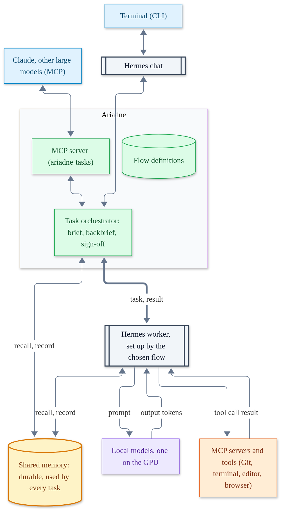
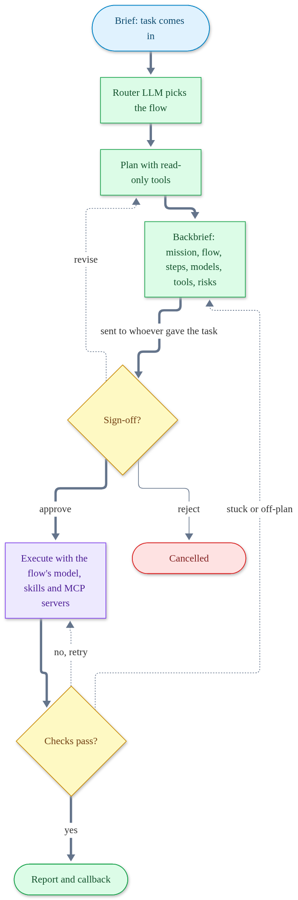

<p align="center"></p>

# Ariadne

A local-model coding agent built on [Hermes Agent](https://github.com/NousResearch/hermes-agent). Give it a task from
the terminal or from Claude (MCP); it plans with read-only tools, sends you a backbrief with a model chosen for
each step, and only executes after you sign off. Models run on your GPU.

**Status:** coding flow beta; design (Mermaid), writing and content flows shipped, not yet validated.



## Requirements

- Windows, Linux or macOS (Apple Silicon); an NVIDIA GPU with 8 GB+ (Windows/Linux) or Apple Silicon
- [git](https://git-scm.com) and [uv](https://docs.astral.sh/uv/getting-started/installation/); the installer adds the rest

## Install

```sh
git clone --recursive https://github.com/satellitebots/ariadne && cd ariadne
uv run --no-project --python 3.14 python -m ariadne install --system
```

`install` checks every dependency first and installs what is missing: Ollama and Node.js (`--system`), Hermes
(git submodule), the Python env and pinned binaries (sha256-verified). Larger models are fetched the first time a
signed-off plan uses them; add `--models` to fetch the defaults now (~50 GB). Check only: `python -m ariadne doctor`.

Then activate the environment: `source .venv/bin/activate` (Linux/macOS) or `.venv\Scripts\activate` (Windows).

## Run

```sh
python -m ariadne up          # models + MCP endpoint on 127.0.0.1:8791 (add --lan for other machines)
```

**Terminal**

```sh
python -m ariadne chat        # chat with Hermes; ask it to give Ariadne a task
python -m ariadne task submit "Fix the failing test" --workspace /path/to/repo --wait 900
python -m ariadne task submit "Diagram the auth flow" --flow design --session auth-work   # continue a session
python -m ariadne task approve <id>     # or: revise <id> "feedback" / cancel <id>
python -m ariadne task approve <id> --model 2=gemma-4-12b   # change a step's model, then lock the plan
python -m ariadne task wait <id>        # the report
```

**MCP (Claude, other large models)**

```sh
python -m ariadne connect     # prints configs for Claude Code, Claude Desktop and other MCP clients
```

Tools: `submit_task`, `wait_task`, `approve_task`, `revise_task`, `cancel_task`, `get_task`, `list_tasks`.



## Models

Each step of a plan gets a model; your sign-off locks them, and nothing runs until every chosen model and tool is
installed. `python -m ariadne models` lists them.

Sized for an 8 GB GPU with 32 GB of RAM; larger models run partly on the CPU.

| Use | Default | Also |
|---|---|---|
| Coding | Qwen3.8 27B (slow) | Qwen3.6 35B-A3B (MoE, faster), Qwen3.5 9B (quick steps) |
| Design | Gemma 4 12B | Gemma 4 26B-A4B |
| Writing | Gemma 4 26B-A4B (MoE) | Gemma 4 31B (best prose, slow) |
| Images | Z-Image-Turbo | SD Turbo |
| Routing, memory | Qwen3.5 4B, Qwen3 Embedding 0.6B | |

**Sessions.** Each task runs in one Hermes session (plan, revisions, execute). Pass `--session` (CLI) or
`session` (MCP) to continue your own conversation across tasks. After each run the model's KV cache is saved to
disk under the session, and restored when that session next runs on that model, so a model swap costs prefill once.

## Configure

- Flows: `flows/<name>/flow.yaml` - coding, design, writing, content (model, skills, MCP servers, checks,
  `network.blocklist`, `browser.real_logins`).
- Models: `serving/models.yaml` (role defaults, Hugging Face source, llama-server args).
- MCP servers a flow can use: `flows/mcp_servers.yaml` (memory, git, vscode, browser, export, image, diagram, text).
- Shared memory, tasks and logs: `.ariadne/`.

## TODO

- Slack channel
- Validate the design, writing and content flows

## License

MIT (`LICENSE`). Hermes Agent: MIT, Nous Research. Image: *Ariadne in Naxos*, Evelyn De Morgan, 1877 (public domain).
