# Case study: designing and building a company RAG with local models

Ariadne is a harness around [Hermes Agent](https://github.com/NousResearch/hermes-agent) that runs work through a
fixed drill: brief, check gates, a read-only plan, a backbrief you sign off, execution, and a QA loop. This case
study puts it through one real job: design a permission-aware RAG for a company, then build version 1 of it over the
Kubernetes documentation. Everything ran on one laptop, using local models only.

**Machine:** RTX 3070 Laptop (8 GB VRAM), 32 GB RAM, Windows 11. llama.cpp b12359 behind llama-swap, Hermes pinned
at `458a0046ad`. Run dates: 17-18 November 2026.

**Status when this was written (18 Nov, 11:00):**

| Piece | Status |
|---|---|
| Warm-up: todo app (coding flow) | Done. All 5 gates passed, 18 tests. Its own case study: [TODO_case_study.md](TODO_case_study.md) |
| RAG design (design flow) | Done. About 85%, which clears the 80% bar set for it. |
| RAG build v1 (coding flow) | In progress: QA iteration 3. The core library and 24 tests are done. The real ingest, README transcripts and eval are not done yet, held back by model swap thrash (see below). |

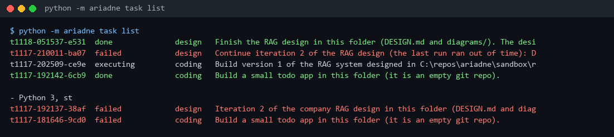

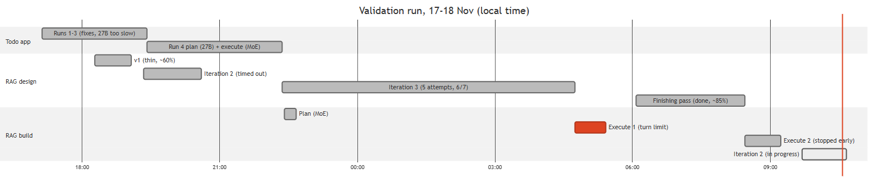

## How a task runs

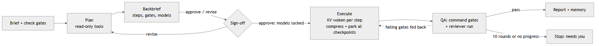

- **Gates come first.** A task without check gates doesn't start; the brief is sent back with a question. There
  are two kinds of gate. Command gates (`run: pytest -q`) must exit 0. Review gates are judged by a separate
  read-only reviewer run, which has to cite evidence.
- **The plan is read-only.** The planner can read files, search and recall memory, but can't change anything. Its
  backbrief maps every gate to the step that makes it pass, and assigns each step a model.
- **Sign-off locks the models.** I overrode the planner's model choices at nearly every sign-off. The reasons are
  in the lessons below.
- **The QA loop has an end.** Failing gates go back to the executor. The loop stops at 10 rounds, or earlier when
  two rounds in a row fail as many gates as the one before.
- **Sessions are chained.** A task's work lives in Hermes sessions split into segments. At each checkpoint (after
  the plan, after each step group, after QA) the model writes a handoff brief, and the next segment starts from it.
  Context is compressed at 30K tokens. The model server's KV cache is saved ("parked") per session, step and model,
  and reloaded ("woken") when that session resumes.

## Speed: the model choice decided everything

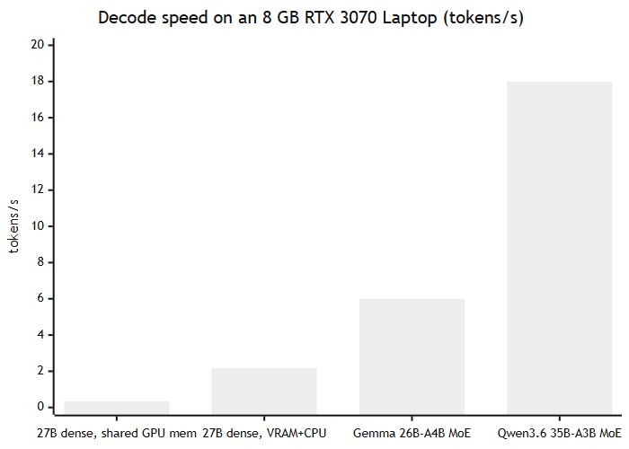

| Model on 8 GB VRAM | Decode | What it meant here |
|---|---|---|
| Qwen3.8 27B dense, overflowing into shared GPU memory | 0.35 tok/s | A plan checkpoint ran 25+ minutes. Every token streams over PCIe. |
| Qwen3.8 27B dense, VRAM + CPU | 2.17 tok/s | A 35-minute plan for a todo app. A 15.9K-token KV file is 1.7 GB. |
| Gemma 4 26B-A4B (MoE, 4B active) | ~6 tok/s | Design work. A plan checkpoint took 2 minutes instead of 11 on the 27B. |
| Qwen3.6 35B-A3B (MoE, 3B active) | ~18 tok/s | Became the default planner and executor. |

The dense 27B planned well; the todo app's plan was the best of the run. But at 2 tok/s, a small app took hours.
Mixture-of-experts models with about 3B active parameters were roughly 8 times faster on the same card. Ariadne
now prefers them by default.

"Use the shared GPU memory" sounded like a free win, but it made the 27B six times slower. The resource profile
called "max" was redefined after measuring this: VRAM plus CPU, with the model pinned in RAM.

Each model call is logged with its prompt size, output size and latency. Calls whose prompt was mostly cached
return in a few seconds; a cold prompt of about 24K tokens took 73 s:

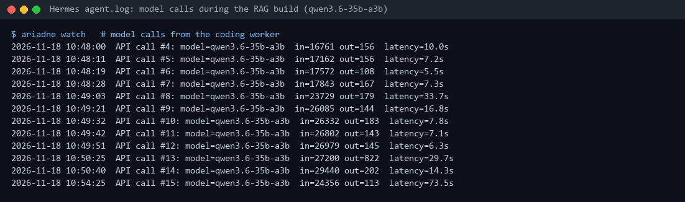

**KV park and wake worked as intended.** For example, 22,689 tokens woke in 2.3 s, 38,152 in 2.2 s, and 29,056
parked in 1.1 s. Without it, each of those would have been a fresh prefill.

## The design: from thin to buildable

The brief asked for a permission-aware RAG for a company with folders spread across many places (SMB, SharePoint,
Confluence, Git), up to 2 million documents, designed with Mermaid diagrams. The bar was an actual design at 80%.
A description of how a design would be produced did not count.

| Pass | Result | What held it back |
|---|---|---|
| v1 | About 60%. All sections present. | Thin: permissions filtered on a list of allowed document ids, which doesn't scale to 2M documents; "X or Y" instead of choices; no numbers; keyword index never fed in the diagram. |
| Iteration 2 | Timed out at 30 minutes, mid-rewrite. | A run that timed out was marked failed. Fixed: it now goes to the gates. |
| Iteration 3 | 5 attempts: 5/7, then 6/7, 6/7, 6/7, stopped for no progress. | Hermes refused 21 writes; diagrams rendered outside the workspace (see below). |
| Finishing pass | Done. 3/3 review gates, 2/2 command gates. | Nothing at the bar. Open: the disk estimate is asserted, not derived. |

Iteration 3 shows the QA loop working as designed. Each attempt that ran out of its 60 minutes went to the gates
instead of failing. The loop stopped on its own when two rounds in a row did not reduce the failing count:

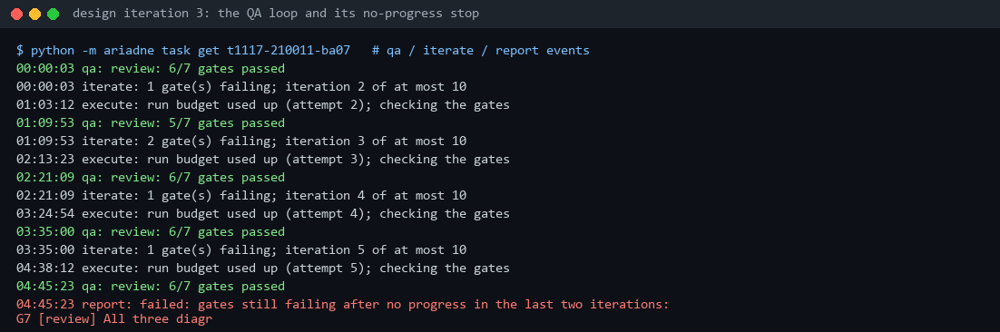

The finishing pass, from approval to done:

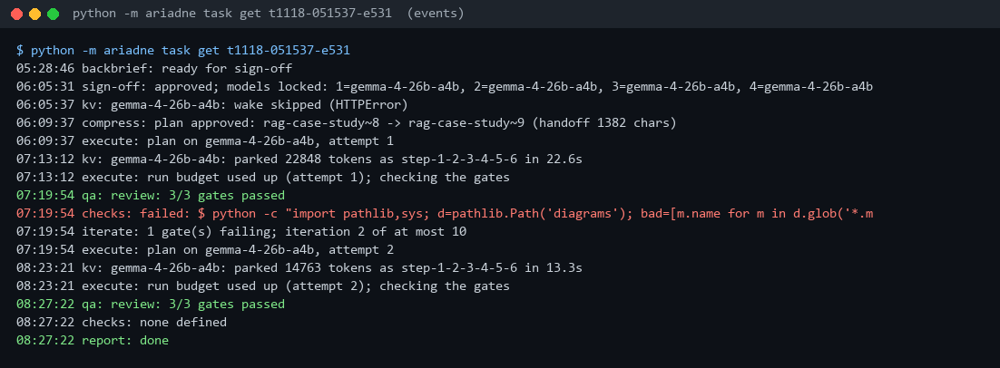

What the final design decides:
- **Access control:** user and group principals are stored on every chunk. At query time the user's groups are
  expanded and the search filters on principals.
- **Search:** hybrid dense and sparse search in Qdrant, followed by a cross-encoder reranker.
- **Models:** `marker` for parsing, the local `embed` model for embeddings, and `qwen3.6-35b-a3b` for answers.
- **Sizing:** 20M vectors x 1024 dimensions x 4 bytes x 1.3 for index overhead comes to about 106.5 GB of RAM.
- **Also covered:** an evaluation plan and the Version 1 scope.

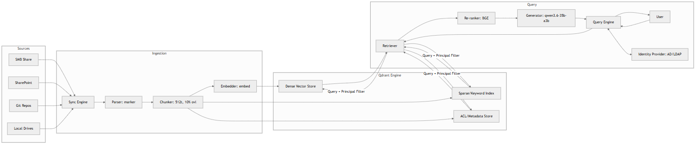

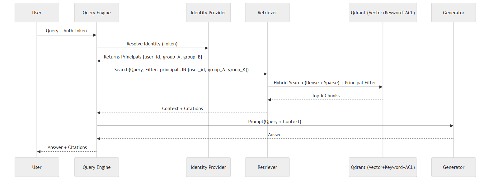

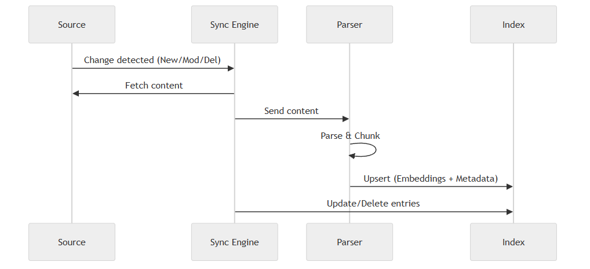

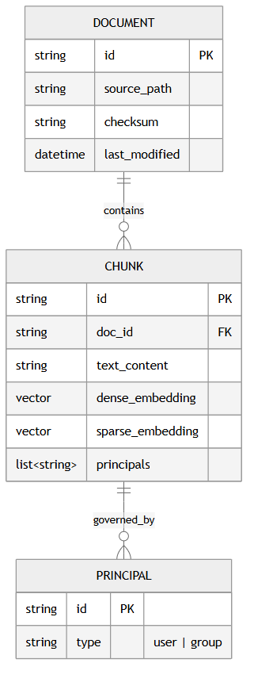

## The build (in progress)

The coding flow builds version 1 over the Kubernetes concepts docs (from `kubernetes/website`), with 7 gates:
- `pytest` passes.
- A real ingest is run, with its counts recorded.
- A real `ask` cites kubernetes.io.
- A test proves the principal filter.
- Eval hit rate is at least 0.7.
- Search is hybrid, and the code shows where the vector and keyword results are merged.
- The tree is clean.

So far:
- The plan took 15 minutes on the MoE.
- The library is done: chunker, hybrid index, retrieval, ACL, generator, eval and CLI.
- 24 tests pass.
- The first execute run hit Hermes' 40-turn limit and was wrongly marked failed. The second fixed a real BM25 bug
  (negative scores on tiny corpora) and committed.
- QA then failed 4 gates: no README, no real runs, no eval number. Iteration 2 checked out the corpus (227 files)
  and fixed the URL mapping, but spent its hour without finishing an ingest. QA after it: 5 gates failing.

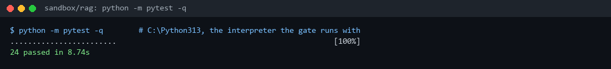

**Why iteration 2 stalled: swap thrash.** The model server ran one model at a time, so each embedding call during
ingest swapped the 0.6B `embed` model in and the 22 GB agent model out. The agent's next call swapped it back,
then re-read a cold 20-50K-token prompt. The laptop ran at 98% GPU and 86 °C for an hour, and most of that work
was reloading:

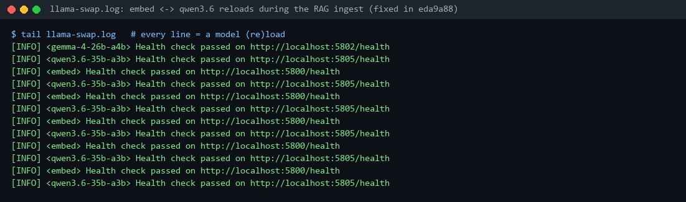

Fix (`eda9a88`): the embedding model now runs on the CPU in its own llama-swap group. It stays loaded and never
unloads anything, so an ingest no longer evicts the agent model. Model-server config changes only between tasks, so
the fix takes effect from the next task. The current build keeps going without it, which is the trade-off of not
interrupting a running task.

What a person sees while this runs, the same status the desktop plugin shows:

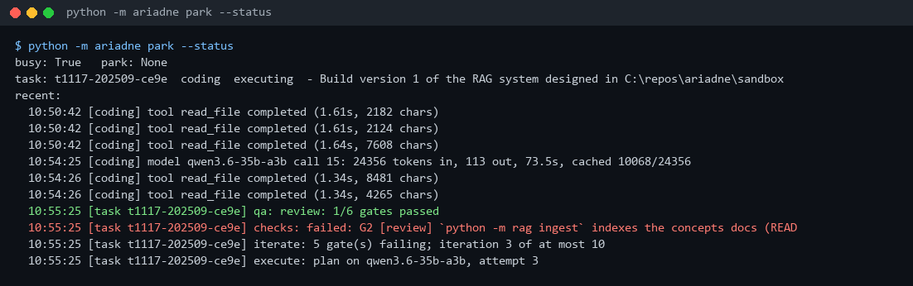

## What broke, and what changed in Ariadne

Every failure below came from an actual run. Each fix is in the repo.

| Symptom | Cause | Fix |
|---|---|---|
| Resume rejected | Hermes refuses `-m/-t/--max-turns/--run-budget` when resuming a session | Start a segment with full arguments, then resume by session id with none |
| KV slot held 561 tokens instead of 13K | Hermes title generation ran on the main model after the run and replaced the slot | Title model upgrade turned off |
| A killed run kept the GPU busy | The per-home Hermes gateway kept generating for a dead client | Stop the gateway on timeout |
| A model reloaded mid-request | A llama-swap config reload restarts models | Config changes only between tasks |
| Timed-out and out-of-turns runs marked failed | Only exit 0 went to QA | Both now go to the gates; the QA loop decides |
| 21 refused writes, then a duplicated design | Hermes won't overwrite a file read only in pages; the model appended instead | Design skill: read the whole file or use patch, never append a copy |
| Diagrams rendered to the user's home folder | The MCP tool resolved relative paths against its own working directory | MCP output tools require absolute paths |
| Freshness gate could never pass | Rendering the SVG rewrote the `.mmd` after the PNG was written | An unchanged `.mmd` is left alone |
| Command gate failed: `No module named pytest` | Gates run in the system shell, not the agent's environment | Planning skill: run gates exactly as written. A per-workspace environment is on the TODO list |
| A debug script left in the repo root | Hermes blocks `python -c` one-liners in headless mode | Planning skill: scratch scripts go outside the tree |
| An hour of ingest with no result, laptop at 86 °C | Each `embed` call swapped out the 22 GB agent model | Embeddings run on the CPU, persistent, beside the agent model |
| Chat waited 99 s with no output | One GPU slot, and the task was mid-generation | A desktop plugin shows status, and Park/Resume is a deliberate choice that pauses the task at a step boundary |

## Lessons

1. **Pick models by active parameters, not total.** On 8 GB, a 3B-active MoE beat a 27B dense model by about 8x
   with no visible quality loss on these tasks. The planner kept spreading steps across three models. One model per
   codebase or document is the better default, because every switch costs a reload and a prefill.
2. **Gates beat judgment.** Review gates missed a design that appeared twice in one file. A five-line command gate
   ("no `##` heading appears twice") cannot be argued past. Use commands for anything a command can check.
3. **Out of time is not failure.** Timeouts and turn limits send the work so far to the gates. The no-progress stop
   then ends loops that are no longer improving.
4. **Skills from feedback work when they are specific.** Each sign-off and review produced a lesson written by the
   larger model, committed to `skills/<flow>/`. Later runs loaded them; for example, the design pass after the
   paths-and-patch lesson rendered correctly on its first attempt.
5. **Local models narrow when resumed.** After a resume, the executor fixed the last bug it was on and declared the
   whole task done. Next improvement: on a re-run, list the plan steps that have no evidence yet, not only the
   failing gates.

## Reproduce

```sh
python -m ariadne install --models
python -m ariadne task submit --file brief.md --workspace <folder> --flow design --session rag
python -m ariadne task wait <id>          # backbrief
python -m ariadne task approve <id> --model all=gemma-4-26b-a4b
python -m ariadne watch                   # follow it live
```

The design and build workspaces are local sandboxes and are not committed. This folder holds only the case study
and its images.
