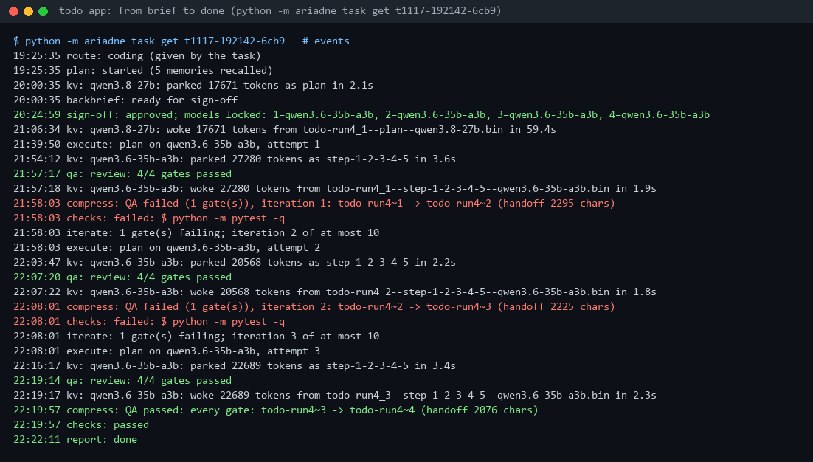
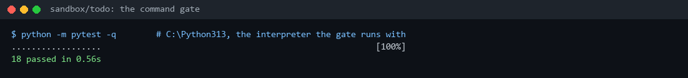
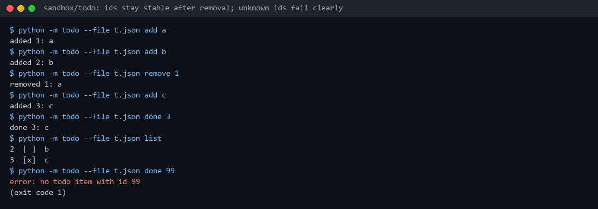

# Case study: a todo app, the coding flow's first full run

The first job Ariadne ran end to end: a small command-line todo app, built in an empty git repo by local models on
a laptop. It is a small task on purpose. It shows the whole drill working once (brief, gates, plan, sign-off,
execute, QA, report), and it surfaced most of the harness bugs that the later RAG work would have hit.

**Machine:** RTX 3070 Laptop (8 GB VRAM), 32 GB RAM, Windows 11. llama.cpp b12359 behind llama-swap, Hermes pinned
at `458a0046ad`. Run date: 17 November 2026.

**Result:** done. Every gate passed after 3 QA rounds: 18 tests, a README and a clean commit (`8480a7e`).

## The brief and its gates

The brief asked for a stdlib-only Python package with JSON storage and five commands (`add`, `list`, `done`,
`remove`, `clear-done`), stable ids, clear errors, pytest tests and a README, committed when the tests pass.

The gates, written before anything started:

| Gate | Kind |
|---|---|
| `python -m pytest -q` passes | command |
| Every command has a test; unknown ids give a clear error and a non-zero exit | review |
| After `add a`, `add b`, `remove 1`, `add c`, the ids listed are 2 and 3 | review |
| README documents every command and the storage-file override | review |
| The work is committed (clean working tree) | review |

## Four runs to get there

The task itself never changed. The first three runs failed on the harness, not the app:

| Run | What happened | Fix in Ariadne |
|---|---|---|
| 1 | Failed at plan: Hermes rejects model and toolset flags when resuming a session | Start each session with full flags, then resume it by id without them |
| 2 | The dense Qwen3.8 27B ran steps 1-2 for 32 minutes at ~2 tok/s without writing a file | 27B plans only; execution moved to the Qwen3.6 35B-A3B MoE, reasoning set to low |
| 3 | The 27B's plan ran out of its 15-minute budget, and the KV save then took 411 s | Plan budget raised to 45 minutes; a stopped run now also stops its Hermes gateway |
| 4 | Done | |

## Run 4

**Plan: 35 minutes on the 27B.** Slow, but the best plan of the whole validation. The planner noticed the
workspace already held a package from run 2, read it, and planned around it:
- smoke-test the existing code first;
- tests use `tmp_path`, never the workspace's `todo.json`;
- a `.gitignore`, so running the tests can't dirty the tree before the "clean tree" gate;
- the exact id-stability sequence from gate 3 as a test.

**Sign-off:** approved with every step on `qwen3.6-35b-a3b`. The plan's KV cache was parked (17,671 tokens in
2.1 s) and woken for the checkpoint.

**Execute: 15 minutes on the MoE** (21:39-21:54). Tests, README, `.gitignore` and the commit.

**QA: three rounds for one gate.** The reviewer passed all four review gates every round. The command gate failed
twice: Ariadne runs gates in the system shell, where `python` was a Python 3.13 without pytest, while the agent had
run its tests with a different interpreter. On round 3 the agent installed pytest for that interpreter, and every
gate passed. Each round woke its parked cache in about 2 s (20-27K tokens).

## Checking it myself

The command gate, run the way QA runs it:

Gates 2 and 3 by hand: ids stay stable after a removal, and an unknown id fails with a clear message and exit 1:

## Lessons

1. **Dense models plan well and execute slowly.** On 8 GB the 27B wrote the best plan of the run, but at ~2 tok/s
   it could not finish a small app. Plan on whatever thinks best; execute on a fast MoE.
2. **Gates must run in the same environment as the work.** Three QA rounds went to `No module named pytest`. That
   is now a lesson in the shared planning skill (run every gate command exactly as QA will, and install what it
   needs there); a per-workspace environment is on the TODO list.
3. **A good plan checks what is already there.** Starting with a smoke test of existing code instead of rewriting
   it saved most of the execute time.
4. **The harness bugs surface on the smallest task.** Resume flags, KV slot overwrites, gateways left generating:
   all were found here, before the RAG work depended on them.

The RAG design and build, the larger case study, is in [RAG_case_study.md](RAG_case_study.md).
