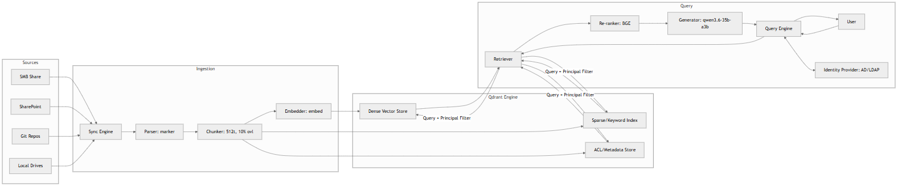
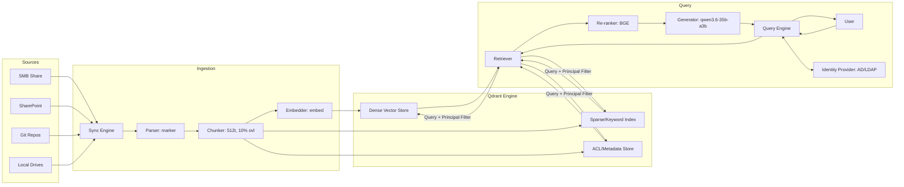
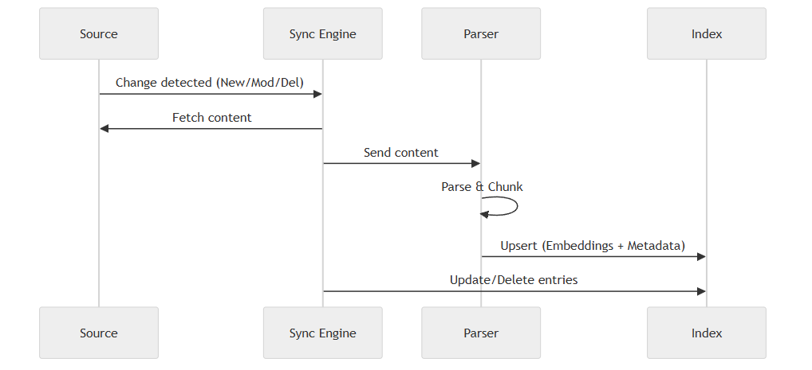
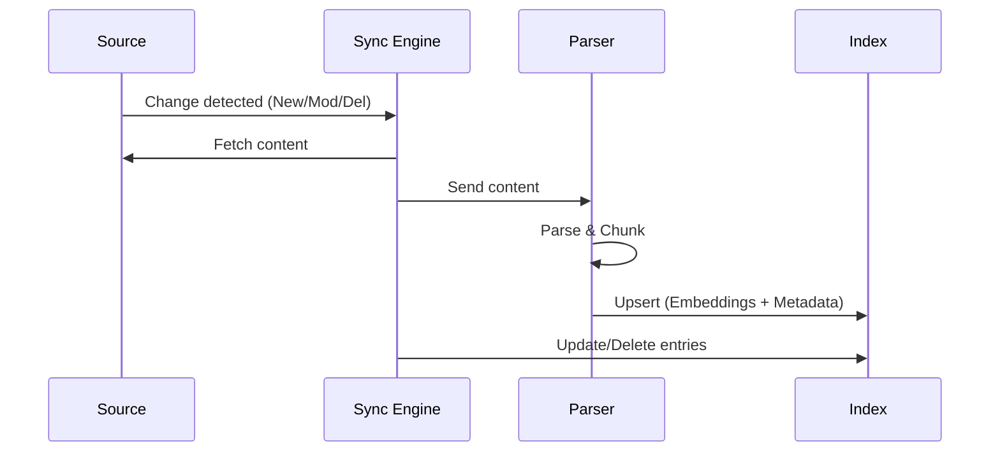
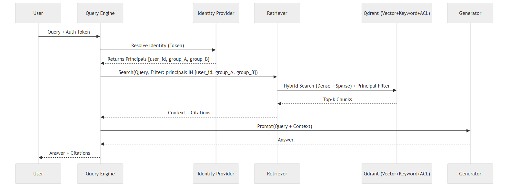
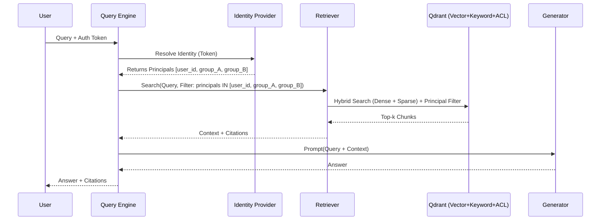
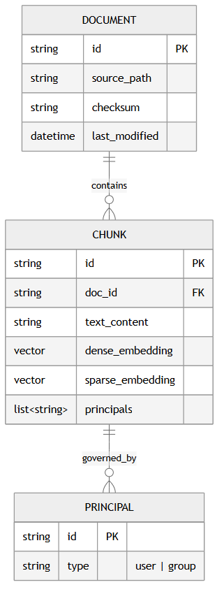
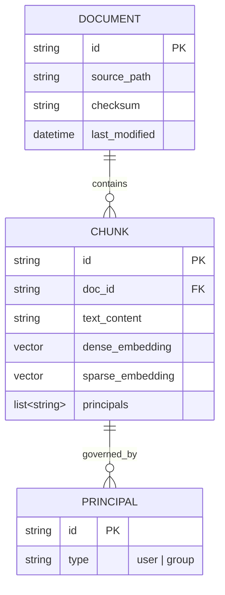

# Design: Local-First Permission-Aware RAG System

## Overview
A RAG system designed for mid-size companies, emphasizing local execution, privacy, and granular access control for up to 2 million documents.

## Requirements

### Connectors and Crawling
- **Incremental Sync:** Connectors for SMB, SharePoint, Confluence, Git, and Local Drives track changes using timestamps, hashes, or native change logs.
- **Deletion Handling:** Hard/soft deletes in sources are propagated to the index via tombstone records.
- **Freshness:** Permission changes in source systems trigger a re-sync of the document's metadata (principals) in the index.

### Access Control (ACL)
- **Identity Integration:** Integration with company LDAP/AD.
- **Granular Enforcement:** Principals (users and groups) are stored as metadata on every chunk.
- **Query-Time Filtering:** At query time, the user's identity is expanded into a list of principals (user ID + group IDs). The retriever applies a metadata filter (e.g., `principals IN [user_id, group_A, group_B]`) directly within the vector/keyword search. This avoids the unscalable approach of filtering by document ID lists.

### Ingestion
- **Multi-format Parsing:** `marker` for high-speed, high-accuracy PDF and document-to-markdown conversion.
- **Chunking:** Fixed-size semantic chunking (512 tokens) with a 10% overlap to preserve context.
- **Deduplication:** Content-based hashing to avoid indexing redundant file versions.

### Indexing and Retrieval
- **Hybrid Search:** Simultaneous dense vector search and sparse keyword (BM25-style) search.
- **Re-ranking:** A local cross-encoder refines the top-k results before generation.
- **Citations:** Every claim is mapped to a specific source document and file path.

## Component Choices

| Component | Choice | Reason |
|---|---|---|
| **Vector Store** | Qdrant | High performance with native payload filtering for ACLs. |
| **Keyword Index** | Qdrant (Sparse) | Simplifies the stack by using a single engine for hybrid search. |
| **ACL Store** | Qdrant Payload | Stores principals on each chunk for efficient, scalable query-time filtering. |
| **Parser** | marker | High-speed, high-accuracy PDF and document-to-markdown conversion. |
| **Chunker** | Fixed-size (512t) | 512 tokens with 10% overlap to preserve local context. |
| **Re-ranker** | BGE-Reranker-v2-m3 | State-of-the-art cross-encoding performance for local deployment. |
| **Generator** | qwen3.6-35b-a3b | High reasoning capability, optimized for local deployment. |
| **Embeddings** | `embed` (Qwen3 0.6B) | Local serving at `http://127.0.0.1:8090/v1`. |

## Sizing (2 Million Documents)
Estimated requirements for a 2M document corpus:
- **Estimated Chunks:** 20,000,000 (avg. 10 chunks per doc)
- **Vector Count:** 20,000,000
- **Embedding Dimension:** 1024 (float32)
- **RAM Calculation:** 20,000,000 vectors * 1024 dimensions * 4 bytes/dim * 1.3 (HNSW overhead) = 106.5 GB
- **Disk Space:** ~150 GB (including indices and metadata)
- **Ingestion Time:** ~6 hours on a single modern machine (1k chunks/sec)
- **Sharding Strategy:** Distribute by document ID across multiple Qdrant nodes when scaling.

## Evaluation
- **Golden Set:** 50-100 curated Question-Answer pairs from the target corpus.
- **Metrics:**
  - **Faithfulness:** Does the answer follow only the retrieved context?
  - **Answer Relevance:** Does the answer actually address the query?
  - **Context Precision:** Are the most relevant chunks at the top of the retrieved set?

## Version 1: Kubernetes Documentation
- **Corpus:** `https://kubernetes.io/docs/` (complete web crawl).
- **Components:** Qdrant, marker, `embed` (Qwen3 0.6B), qwen3.6-35b-a3b, BGE-Reranker.
- **Out of Scope:** SharePoint/Confluence connectors (V1 uses web crawling/local folder sync), enterprise monitoring, complex multi-user audit logs.

## Diagrams

### Architecture Overview

[Source: diagrams/architecture.mmd](diagrams/architecture.mmd)

### Ingestion Sequence

[Source: diagrams/ingestion.mmd](diagrams/ingestion.mmd)

### Query-time Sequence

[Source: diagrams/query.mmd](diagrams/query.mmd)

### Data Model

[Source: diagrams/datamodel.mmd](diagrams/datamodel.mmd)

