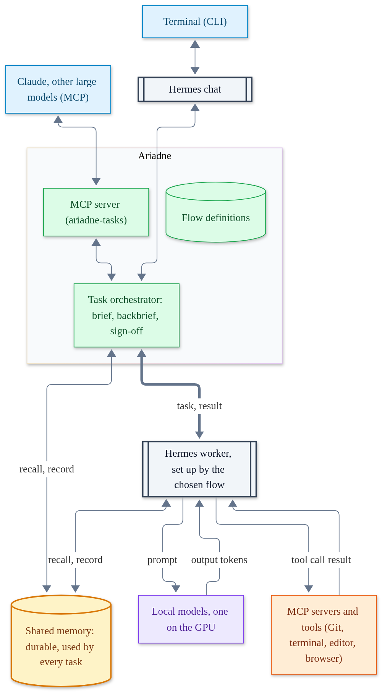

# Architecture



## The pieces

| Piece | What it is | Where |
|---|---|---|
| Entry points | Terminal (`python -m ariadne task ...`, `chat`), Ariadne Desktop (rebranded Hermes desktop), MCP for Claude and other large models (`ariadne-tasks` server, local or over HTTP with a bearer token) | `__main__.py`, `desktop.py`, `tasks_mcp.py`, `host.py` |
| Task store | SQLite: tasks, events, sessions, jobs | `.ariadne/tasks.db`, `orchestrator.py`, `jobs.py` |
| Worker | Routes a task to a flow, runs plan, checkpoint, execute, QA and jobs; detached from any session | `orchestrator.py` (`Worker`), `procs.py` |
| Hermes runs | Each phase is one headless `hermes chat` run in the flow's own Hermes home, resumed by session id | `orchestrator.hermes_run`, `.ariadne/homes/<flow>` |
| Flows | One folder per kind of work, compiled into a Hermes home (config, toolsets, MCP servers, skills, plugins) | `flows/`, `flows.py` |
| MCP servers | memory, jobs, web, git, browser (Chrome DevTools MCP), diagram, image, export, text, vscode | `*_mcp.py`, `flows/mcp_servers.yaml` |
| Hermes plugins | `ariadne_phase`: the plan phase may only call read-only tools, and every tool call is logged. `offline_guard`: a strict no-network mode for the `guard-proof` profile | `plugins/` |
| Model server | llama-swap + llama.cpp. Agent models swap on one GPU; the embedding model sits in a persistent CPU group | `serve.py`, `serving/` |
| Resources | Measures the machine at boot, sets limits per profile | `resources.py`, `.ariadne/limits.json` |
| KV cache | Saves and restores llama.cpp slots per session, step and model | `kvcache.py`, `.ariadne/kv/` |
| Memory | A small graph in SQLite with full-text recall, shared by every task | `memory.py`, `.ariadne/memory.db` |
| Activity | One log per day; the watch window merges it with the worker, model server and Hermes logs | `activity.py`, `.ariadne/logs/` |

## Processes

```
you ──► terminal / desktop / MCP ──► tasks.db ◄──► worker (detached)
                                                   │
                                                   ├─► hermes chat (one run per phase, flow home)
                                                   │      └─► MCP servers (stdio): memory, jobs, web, git, browser ...
                                                   ├─► jobs (shell, model unloaded)
                                                   └─► llama-swap :8090 ──► llama.cpp (agent model on GPU, embed on CPU)
```

The worker and llama-swap are started *detached*. On Windows they break away from the caller's job object, or
start through WMI when that is not allowed, so closing a terminal or losing a remote session does not kill them.
They stop only through `ariadne stop` or the watch window. See [Operations](Operations.md).

## What lives where

- `upstream/`: Hermes, as a git submodule pinned to `458a0046ad`. It is never edited. A contract test
  (`test_hermes_contract.py`) fails loudly if a Hermes update moves something Ariadne relies on.
- `.ariadne/`: all state (tasks, memory, KV caches, logs, worker homes, desktop data, limits). It is not checked in.
- `case_study/`: write-ups plus snapshots of the projects the models built (`case_study/projects/`).
