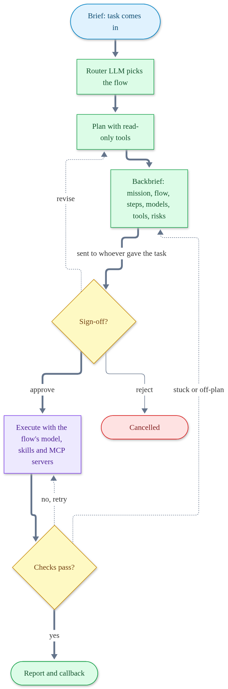

# Task lifecycle

| # | Phase | Who | What happens |
|---|---|---|---|
| 1 | Brief | You | Task text, workspace (optional), check gates. With no gates, the planner proposes 1-3 in the backbrief and sign-off approves them with the plan. |
| 2 | Route | Router model | Picks the flow, unless you named one. |
| 3 | Plan | Flow's planner | Read-only tools only (enforced at dispatch: the plan phase is not offered write tools). Reads the workspace, searches the web and docs, recalls memory. |
| 4 | Backbrief | Planner → you | Mission, steps, a model per step, a gate→step map, risks. Status `awaiting_signoff`. |
| 5 | Sign-off | You | Approve (optionally overriding a step's model), revise with feedback, or cancel. Approving locks the plan. |
| 6 | Execute | Each step's model | Each link of the model chain runs in order. A checkpoint between groups writes a handoff brief. Heavy work goes out as [jobs](Jobs.md). A needed login [pauses the task](Web-and-Browser.md). |
| 7 | QA | Gate commands + reviewer | Command gates run; review gates are judged by a separate read-only reviewer run. Failures go back to step 6 with the reasons. |
| 8 | Report | Worker | What changed and how it was verified. Status `done`. |

## Statuses

`planning` → `awaiting_signoff` → `executing` → `done`

(`awaiting_gates` remains only for tasks created before 0.1.1; submit no longer produces it.)

Off the main path:
- `needs_attention`: the task needs you. This happens when you stopped Ariadne, a model is missing, or the QA loop
  ran out of rounds.
- `failed`: an error the worker could not recover from.
- `cancelled`: you cancelled it.

Approving a `needs_attention` task continues it, keeping the work so far.

## Limits that end a loop

| Limit | Value | When it is hit |
|---|---|---|
| QA rounds | 5 (one run + four retries) | `needs_attention` with the failing gates |
| No progress | 2 rounds with no fewer failing gates | Stops early |
| Turns per run | coding: plan 20, execute 80 | The gates decide whether it is done |
| Run budget | coding: plan 45 min, execute 60 min | Same: the gates decide |
| Job cycles per run | 40 | Stops submitting jobs |

Running out of turns or time is not a failure: what the model wrote stays, and the gates decide. This was learned
on RAG v1, where a 40-turn limit marked good work as failed.

## Sessions are durable

A **session** is the workstream a person lives in; a **task** is one thing that happens inside it. One session holds
many tasks, each with its own plan, gates and report, sharing the session's memory, workspace and Hermes segment. A
new task in a session can omit the workspace: it continues where that session last worked. A brand-new session starts
in the folder you are in. The chat is the intake: it gathers the flow, model and gates (proposing gates itself when
they are missing) and hands the task to the worker, then sleeps.

Steering: `ariadne steer ID "..."` (or `steer_task` over MCP) queues a note for a planning or executing task. The
worker prepends it to the next execute prompt, and it wins over the plan where they conflict. Delivery is at the next
step boundary; a note sent while a link is running waits for that boundary.
